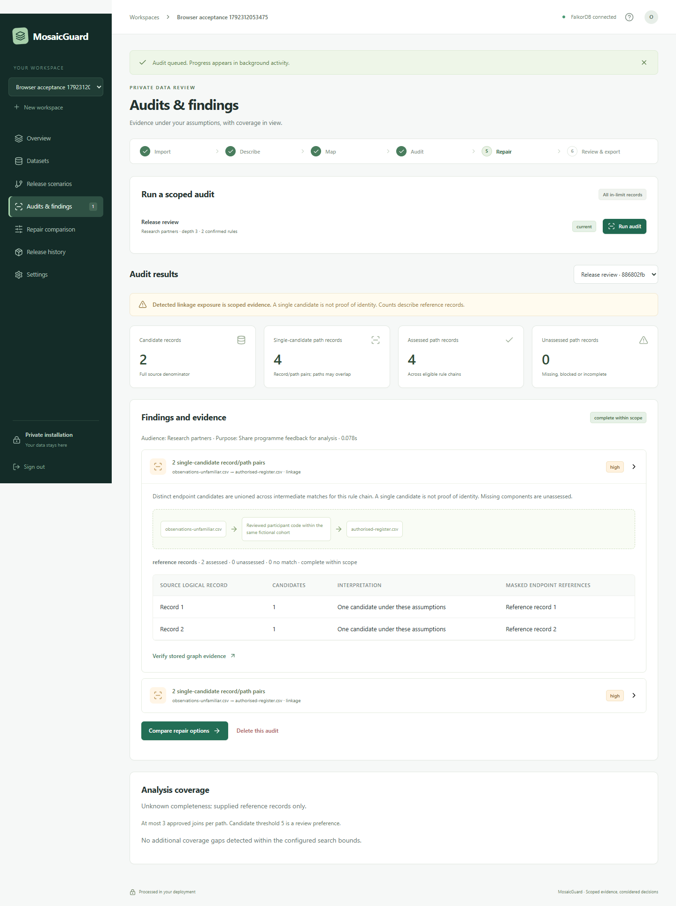

# MosaicGuard

Private, self-hosted dataset release review. Import your own CSVs, confirm what columns mean, investigate scoped linkage exposure with **real FalkorDB**, test immutable repair branches, and download a reproducible release package.

This product reports evidence under a supplied-data and attacker-knowledge model. A single candidate is **not proof of identity**. No matches do not establish anonymity, legal compliance, or a differential-privacy guarantee.



## Start locally

Requires Docker Desktop with Linux containers and Python 3.14 (Python is used only for initial configuration if using Docker).

```powershell
git clone https://github.com/harshitdeora/mosaicguard.git
cd mosaicguard
python scripts/configure.py
docker compose up --build -d
```

Open **http://127.0.0.1:8027** and create your owner account. Back up `.env` securely outside Git **before importing data**. Configuration never overwrites an existing key. The app binds to localhost; the graph uses password-protected localhost port 6397. No hosted service is created.

To stop: `docker compose stop`. To resume: `docker compose up -d`. Avoid `docker compose down -v`, which removes the durable data volumes.

## Supported workflow

1. Create a private workspace; upload CSVs or explore two small, locally generated fictional CSVs.
2. Correct delimiter, encoding, quoting and null settings; review types, meanings, dataset role and row unit. Originals remain immutable.
3. Define an audience, purpose, candidate versions, available references, confirmed exact/composite or typed-compatible rules, diagnostics and analytical requirements.
4. Profile fan-out and run a durable audit. Inspect separate paths, masked local evidence, class sizes, assumptions and missing coverage.
5. Test up to ten repair recipes: remove columns, suppress values, or generalise reviewed numeric/date fields. Each branch receives a new version, graph projection, full re-audit and utility comparison.
6. Review residual findings and analytical conflicts; create a digest-bound ZIP. Reversible spreadsheet transport escaping receives no privacy credit.
7. Record sharing separately with **Record as released**. Historical versions remain available to that audience in later scenarios.

**Conservative limits:** 2 MB/file, 1,000 logical data records/file, 50 columns, 8,192 characters/cell, 5,000 imported records/workspace, 3 joins/path, 100 paths, 20,000 endpoint results/path, 250,000 typed comparisons/rule. Bounds produce partial coverage, never artificial uniqueness. See [measured benchmark](docs/benchmark.json).

## Development and checks

Python 3.14 and Node 22.19+; Docker provides the real graph. Commands below work in Windows PowerShell from the repository root:

```powershell
python -m venv .venv
.\.venv\Scripts\python.exe -m pip install -r backend/requirements.lock
python scripts/configure.py
docker compose up -d graph
npm.cmd --prefix frontend ci
npm.cmd --prefix frontend run build
.\.venv\Scripts\python.exe -m uvicorn backend.app.main:app --host 127.0.0.1 --port 8027 --no-access-log --log-level critical
```

The Python server serves the production UI. For frontend hot reload, use `npm.cmd --prefix frontend run dev` in another terminal (port 5178, same-origin API proxy).

```powershell
.\.venv\Scripts\python.exe -m pytest backend/tests -q
npm.cmd --prefix frontend run test:browser
.\.venv\Scripts\python.exe scripts/benchmark.py
.\.venv\Scripts\python.exe scripts/restore_smoke.py
```

Browser tests use Edge on Windows. On Linux, run `npx playwright install --with-deps chromium` inside `frontend` first. Tests use isolated directories under ignored `work/`, generated synthetic accounts and their own app port 8028. The restore smoke test restarts **this project's graph service**; run it when no other MosaicGuard jobs are active. No live model call is made by these tests.

## Documentation

- [Five-minute beginner walkthrough and sample data](docs/BEGINNER_TUTORIAL.md)
- [Detailed first-use, CSV preparation and advanced synthetic demo](docs/USER_GUIDE.md)
- [Architecture, graph and candidate-set semantics](docs/ARCHITECTURE.md)
- [Keys, deployment, deletion, backup and restore](docs/OPERATIONS.md)
- [Verification and measured limits](docs/VERIFICATION.md)
- [Exact limitations and remaining hardening](docs/LIMITATIONS.md)
- [Build progress and evidence](PROGRESS.md)
- [Hackathon notes and AI disclosure](docs/SUBMISSION.md)

No external model credential is required. The local assistant is labelled rules-based. An optional OpenAI tool-calling adapter requires a server key, a reviewed payload policy and explicit workspace enablement. Its live execution remains unverified unless separately recorded in verification evidence.

## Internet deployment

The supported public-hosting path is a single-owner Railway deployment with separate app and FalkorDB services and a persistent volume for each. See the [Railway deployment guide](docs/RAILWAY_DEPLOYMENT.md). The setup token prevents another visitor from claiming a fresh public instance. The current product is not a multi-tenant service.
